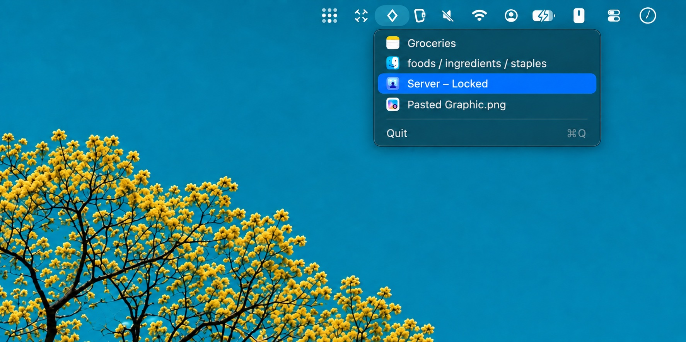

# Minimized Windows

A lightweight macOS app that lists your minimized windows. Right-click the menu bar once, then click a window in the list to restore it.

Useful if you keep your Dock hidden or [**have your Dock disabled**](https://github.com/numeono/macOS#disable-the-dock).

<p align="center">
  
</p>


## Original icon interface

The screenshot below shows the historical icon interface. The current app has no menu-bar icon.



## Controls

- Right-click the menu bar once to leave the list open, then click a window. Click outside the dropdown or press Escape to dismiss it.
- Or hold the right mouse button on the menu bar, slide down into the list, and release over a window to restore it. Releasing without a highlighted item cancels.
- Choose Quit in the dropdown to stop the app.

The dropdown uses a native macOS menu, including the system glass material, corner treatment, spacing, selection highlight, and separator above Quit. It is at least 360 points wide and centered horizontally on the right-click position, with its top edge below the menu bar from the moment it opens. Near a display edge, its position adjusts to keep it visible. The material follows the macOS version, appearance, and accessibility settings. Titles show their first 41 characters followed by an ellipsis when needed. Hover over an entry to see its full title in a tooltip. Each window row has an app icon, with image visibility explicitly enabled on macOS 27. Recently minimized windows appear first.

Ordinary left-clicks and drags pass through unchanged. Left-button drag activation and double-click activation are not enabled. With an automatically hidden menu bar, reveal the bar first. The app registers itself to launch at login.

## Accessibility setup

Without Accessibility access, the app shows a setup window with Open Accessibility Settings and Quit buttons. Enable Minimized Windows in System Settings. The app checks every two seconds and closes the setup window once menu-bar access works. If permission is revoked, the setup window returns. No menu-bar icon is added. Once access works, a one-time “Successfully enabled” window explains how to open the list. Choose Got it to dismiss it; it will not appear on subsequent launches.

## Requirements

- macOS 12.0 (Monterey) or later
- Accessibility permission (required to detect and restore minimized windows)

## Installation

### Build from source

```bash
git clone https://github.com/numeono/minimized-windows.git
cd minimized-windows
bash build.sh
mv "build/Minimized Windows.app" /Applications/
open "/Applications/Minimized Windows.app"
```

The setup window links to:
**System Settings → Privacy & Security → Accessibility → add "Minimized Windows"**

### Requirements for building

- Xcode Command Line Tools (`xcode-select --install`)
- No other dependencies

## Why Accessibility permission?

macOS requires Accessibility access for any app that reads window state from other applications. This app uses it to detect and restore minimized windows and detect secondary clicks on the menu bar.

## How it works

The app uses the macOS Accessibility API (`AXMinimizedWindows` attribute) to query each running application for its minimized windows. It polls lightly in the background (every 2 seconds) to track the order in which windows were minimized. At launch, the app makes one HTTPS request to GitHub to check for a newer stable release. It does not send window titles or other window data.

## Updates

At launch, the app checks the latest published, non-draft, non-prerelease GitHub Release and compares its version tag with the installed app version. Use numeric tags such as `v1.12` or `v1.12.1`. Commits on `main` alone do not trigger an update notice.

If a newer release exists, an Update available window offers View Update and Later. View Update opens that release's GitHub page; it does not download or install an app automatically. The prompt waits until the Accessibility setup, enabled notice, and any open window menu are closed. Later dismisses it for the current launch.

Offline checks, GitHub rate limits, malformed responses, and a repository with no releases are ignored. The app continues working. To distribute an update, publish a GitHub Release with a newer version tag and attach the built app archive.

## Verification

The app builds locally and passes code-signature verification. Native fixture tests exercise an AppKit menu tracking session, action dispatch, and cancellation. They also check icons, separators, title limits, the initial native menu frame below the menu bar, horizontal centering and edge clamping, explicit icon visibility, click and held-drag opening, held release selection and cancellation, release-version comparisons and error handling, left-button passthrough, empty-list behavior, and menu-bar boundary geometry. A screenshot of the new native menu could not be captured in the development session; its appearance still needs a visual check on the target Mac. Live event interception and restoration still need testing in a logged-in macOS session with Accessibility access for this build, including on a notched MacBook.

Run the fixture tests with `bash Tests/run.sh`. They briefly display a native test menu and dismiss it automatically.

Check these cases when testing a new build:

- Minimize two windows, right-click the menu bar, then click each entry in turn. Only the chosen window should restore and activate.
- Right-click once and release. The list should stay open until you choose a window, click outside, or press Escape.
- Hold the right button, slide into the menu, and release over a window. Also check releasing outside the list.
- Cancel with Escape and by clicking outside the menu. Neither should restore a window.
- Test the empty list, ordinary desktop clicks, and right-clicks. Check that left-clicks and drags on app menus and status icons retain their normal behavior and do not open the window list.
- Check placement beneath the cursor and near both horizontal edges of each display.
- Test each connected display, including one above or to the left of the main display, and a revealed auto-hidden menu bar.
- Revoke and restore Accessibility access. The setup window should appear and then disappear without restarting the app.

## License

MIT. See [LICENSE](LICENSE).
